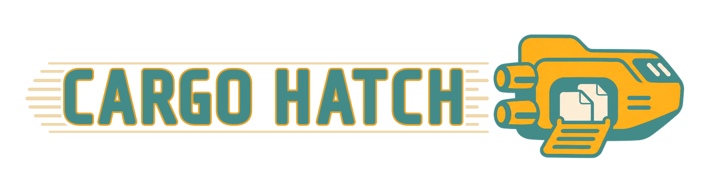

# CargoHatch

<p align="center">
  
</p>


CargoHatch is a file manager for Linux, made for people who spend their day
moving files around. It has two sides, tabs on each, a folder tree and a
favourites bar, and you can drive almost everything from the keyboard. It
follows your desktop's theme, and was made with Omarchy in mind.

**Status:** pre-release. It's in daily use, but settings and behaviour may
still change between versions.

## What it does

**Two sides and many tabs**
- Show one folder or two, side by side or stacked. One side is the source and
  the other the destination, so F5 copies and F6 moves from one to the other.
  Lock a side in its role if you prefer it fixed.
- Tabs on each side, on any edge of the window. Drag them to reorder, move
  them to the other side, reopen closed ones with their history, or switch
  with Ctrl+Tab, most recently used first.
- Colour tabs with your theme's colours (or every tab in a folder and below),
  rename them, give each a home folder, and link a tab to one on the other side.
- Lock a tab to its folder, so other folders open in a new tab and the tab
  can't be closed by accident.
- Several windows, which can pair up as source and destination. Save a set of
  tabs as a group, or every open window as a layout, and open it again later,
  also from the command line (`cargohatch --layout Work`).
- The last window you close comes back, tabs, history and all.

**Getting around**
- A location bar of clickable folders: click › for a folder's sub-folders, or
  click empty space to type a path. Paths complete as you type, and file paths
  open their folder with the file selected.
- Folder aliases like `~downloads`, `~config` and `~trash`, plus your own, wherever
  you type a path.
- Back, forward and up, with history lists and the mouse's side buttons.
  Going up puts the cursor on the folder you came from.
- A folder tree (F9) for the window or for each side, with Home, the file
  system, drives and network mounts, and the trash.
- Favourite folders and files in the Favourites menu, the tree and a bar of
  their own, in branches if you like.

**Seeing your files**
- Seven view modes: large icons, small icons, list, details, power, thumbnails
  and tiles.
- Columns for name, extension, size, type, dates, permissions, owner, group,
  link target and path. Show, hide, reorder and resize them.
- Sort by any column, with folders first, last or mixed, and numbers by value
  (file2 before file10).
- Each tab keeps its own view mode, columns and sort, and the list updates as
  files come and go.
- Hidden files stay hidden until you press Ctrl+H, and you can hide your own
  patterns too.

**Working with files**
- Copy or move to the other side, to any folder you type or pick, or
  duplicate in place. Big jobs show a progress window with speed and time
  left, and can be paused, skipped or left to run unattended.
- When a name is taken, CargoHatch asks and shows both items side by side.
  You can also have it always skip, replace, replace if newer, rename, or
  resume. Folders merge.
- Drag files to the other side, a tab, a folder, the tree, the location bar,
  another window or another program. Ctrl copies, Shift moves, Ctrl+Shift
  links and Alt asks.
- Cut, copy and paste with other file managers, paste as links, and copy
  names or paths as text in several formats.
- Delete moves to the trash; Shift+Delete deletes for good after asking.
- F2 renames in place; press it again to select the whole name or the
  extension.
- Create a folder, a path of folders, or many at once (`Disc {01..12}`).
- Enter opens every selected item: files in their applications, folders in
  new tabs. Shift+F4 opens a terminal here.

**Selecting and finding**
- Type in the list to jump to a name; every match is highlighted and marked
  on the scroll bar.
- The filter bar (Ctrl+F) shows only the names that match, by part of a name,
  wildcards or a regular expression.
- Select by pattern (Ctrl+S), invert the selection, or get back the selection
  from before the last command.

**Fits in**
- Follows the Omarchy theme as it changes, and the theme's accent outlines
  the menus.
- Uses the desktop's folder chooser, your terminal (through
  `xdg-terminal-exec`) and the standard trash.
- Every key is listed under **Help → Keyboard Shortcuts** (F1, or ? in the
  file list), with a search field.

## Install

CargoHatch builds into an Arch package. You need `qt6-base`, `qt6-wayland`,
`gcc` and `make`.

```sh
git clone https://github.com/gsargent70/cargohatch.git
cd cargohatch
bin/install          # builds the package and installs it with makepkg -fsi
```

It then shows up in your app launcher. You can also run `cargohatch` with a
folder or file to open, or `cargohatch --layout <name>` to open a saved layout.

## Build and test

```sh
bin/build            # builds build/cargohatch
build/cargohatch ~   # runs it on a folder
bin/test             # runs the Qt Test suite, offscreen
bin/screenshot       # retakes docs/screenshot.png from made-up files
```

CargoHatch is written in C++17 with Qt 6 Widgets and built with qmake.

## Keys

| Key | Action |
|---|---|
| Enter, double-click | Open (Enter opens every selected item) |
| Ctrl+Enter, Shift+Enter | Open a folder in a new tab, on the other side |
| Alt+Left, Alt+Right | Back, forward |
| Alt+Up, Backspace | Up to the parent folder |
| Ctrl+L | Type a path (Tab completes, `~` lists aliases) |
| Tab | Switch to the other side |
| F5, F6 | Copy, move the selection to the other side |
| Shift+F5, Shift+F6 | Copy, move the selection to a folder you choose |
| Ctrl+X, Ctrl+C, Ctrl+V | Cut, copy, paste |
| F2 | Rename |
| F7 | Create a folder |
| Delete, Shift+Delete | Move to the trash, delete for good |
| Ctrl+A, Esc | Select all, select none |
| Ctrl+S | Select by pattern |
| Typing in the list | Find a name; F3 and Shift+F3 for the next and previous match |
| Ctrl+F | Filter bar |
| Ctrl+H | Show hidden files |
| Ctrl+1 … Ctrl+7 | View modes |
| Ctrl+T, Ctrl+W | New tab, close tab |
| Ctrl+Shift+T | Reopen the last closed tab |
| Ctrl+Tab | Switch tabs, most recently used first |
| Ctrl+Shift+D | Dual display on or off |
| F9 | Folder tree on or off |
| Ctrl+B | Add to favourites |
| Shift+F4 | Open a terminal here |
| Ctrl+N, Ctrl+Shift+W | New window, close window |
| Ctrl+Q | Quit |
| F1, ? | Every key, in a window you can search |

## Settings

Choices that stay set are under the **Settings** menu and apply straight
away. They're saved in `~/.config/cargohatch/cargohatch.conf`. Folder colour
rules live there under `tabColorRules`, with `*` and `?` wildcards, and can be
edited by hand.

## Where it's going

[`docs/FEATURES.md`](docs/FEATURES.md) lists what's built and what could come
next, each with an ID. Features are picked from that list and built, tested
and released one at a time.

## Licence

MIT. See [LICENSE](LICENSE).
