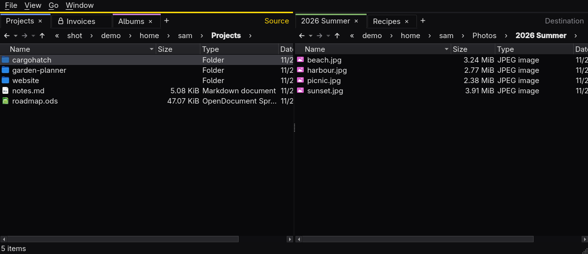

# CargoHatch

<p align="center">
  
</p>



A native Linux file manager for power users: dual-pane Listers, folder tabs,
a scriptable command language, and deep customization.

See [`docs/FEATURES.md`](docs/FEATURES.md) for the feature catalog. Features are
picked from that list by ID and built, tested and released one at a time.

## Status

Pre-alpha. Done so far (IDs from [`docs/FEATURES.md`](docs/FEATURES.md)):

- **LST-02** Single or dual display, side by side or stacked, remembered
  between runs.
- **LST-03** Source and destination sides, with a lock to keep a side in its
  role. With the source locked, F5 and F6 copy and move from it whichever side
  is in use.
- **TAB-01** Folder tabs on each side: new, duplicate, close, reorder by
  dragging, move to the other side.
- **NAV-01** Back, forward, up and root, with history drop-downs on the back
  and forward buttons and the mouse's side buttons.
- **NAV-02** Breadcrumb location bar: click a folder to go there, click › for
  its sub-folders, dimmed "ghost" folders after going up, click empty space
  to type a path.
- **TAB-02** Tab bar on the top, bottom, left or right; vertical tabs keep
  their names level.
- **TAB-04** A + button after the last tab, double-click empty bar space for
  a new tab, and optionally open new tabs beside the current one.
- **TAB-05** When the tabs don't fit, they scroll and a ⌄ button lists them
  all.
- **TAB-07** Close buttons on tabs, middle-click, optional double-click to
  close, and optionally closing the last tab closes the window (or that side
  of a dual display).
- **TAB-12** Reopen closed tabs, with their history.
- **TAB-19, LST-26** A tab list menu and a Ctrl+Tab switcher listing every tab
  in the window, most recently used first.

- **LST-01** Several windows: new (from the default), duplicate, close.
- **LST-04** Two single-display windows pair up as source and destination,
  with a lock to keep a window in its role.
- **LST-06** Swap folders with the other side, show this folder there, or
  open the highlighted folder there.
- **LST-07** Size the split from the keyboard; double-click the divider to
  even it out.
- **LST-20** (in part) The last window closed is remembered, tabs, history
  and all, and is what the next start and New Window open.
- **LST-21** Reopen closed windows.
- **TAB-08** Lock a tab: other folders open in a new tab (or in one reused
  tab), or browse freely but keep a folder to return to. Locked tabs can't be
  closed by accident.
- **TAB-09** Link a tab with one on the other side, so choosing one shows the
  other.
- **TAB-10** Colour a tab, or every tab in a folder and below, with the
  theme's own hues.
- **TAB-11** Rename a tab.
- **TAB-15** Optionally switch to an open tab instead of opening a duplicate.
- **TAB-18** Each tab has a home folder to jump back to.
- **TAB-13** Tab groups: save a window's tabs under a name and open them
  later, replacing or adding to the current tabs.
- **LST-19** Layouts: save every open window under a name and open them all
  again, also from the command line (`cargohatch --layout Work`), which makes
  a desktop shortcut to a layout easy.

Right-click a tab, or use the **Tabs** menu, to rename, lock, colour, link it
or make its folder its home. Tab groups are under **Tabs → Tab Groups** and
layouts under **Window → Layouts**. Choices that stay set, for tabs, windows,
copying, deleting and the rest, are under **Settings**. Folder colour
rules are stored in `~/.config/cargohatch/cargohatch.conf` under
`tabColorRules` and can be edited there, with `*` and `?` wildcards.

- **VIEW-01** View modes: Large Icons, Small Icons, List, Details, Power
  (Details where clicking selects without Ctrl), Thumbnails and Tiles.
- **VIEW-02** Columns: name, extension, size, type, modified, created,
  accessed, permissions, owner, group, link target and full path. Show or
  hide them from the heading's right-click menu, drag to reorder and resize,
  or size them to fit.
- **SORT-01** Sort by any column; clicking a heading sorts sizes and dates
  biggest and newest first, names A to Z, and a second click reverses.
- **SORT-02** Folders first, files first, or mixed; folders can stay in name
  order whatever the sort.
- **SORT-03** Numbers sort by value (file2 before file10), with optional
  word sort (ignoring hyphens and apostrophes) and names compared before
  extensions.

- **COPY-01** Copy or move the selection to the other side, to any folder
  (typed, with completion, or picked with the desktop's chooser; missing
  folders are created), or duplicate it in place. Big jobs show progress and
  can be cancelled; a failed copy never leaves half a file behind.
- **COPY-02** When a name is taken: ask, skip, replace, replace if newer,
  rename the copy, rename the existing item, resume, or move the existing
  item to the trash. Folders merge.
- **DEL-01** Delete moves to the trash; Shift+Delete deletes for good after
  asking. **Settings → Deleting → Delete Moves to Trash** swaps the two.
- **COPY-03** The replace question shows both items side by side, with
  previews, sizes and dates, and which is newer or larger. Replace (or only if
  newer, or trash the old one first), rename the copy (or choose its name, or
  rename the existing item), resume, or skip, for one item or the rest.
  Optionally ask before merging folders; read-only files always get a second
  look unless turned off.
- **COPY-08** Progress window: bars for the file and the whole job, speed with
  a graph, time left, file count, and the percentage in the title. Pause,
  skip the current file, or go unattended (anything that would ask is skipped
  and listed at the end).
- **DEL-02** Delete options: ask before trashing, ask before deleting for good
  (on by default), ask about each file or folder, read-only files, and land on
  the next item afterwards.
- **REN-01** F2 renames in place, with the name before the extension
  selected; F2 again selects the whole name, then the extension. Renaming
  never replaces another item. **Settings → Rename Starts With** picks the
  starting selection.
- **SEL-01** Select all, files, folders, none, invert, and reselect the
  selection from before the last command.
- **SEL-02** Select by wildcards (`*.jpg;*.png`) or a regular expression:
  add, remove, or select only the matches, among files, folders or both.
- **FCMD-01** Create a folder, a path of folders (`a/b/c`), or several at once,
  one per line, with sets like `2026/{Jan,Feb}` and `Disc {01..12}`. Suggests
  names, and selects the new folder, opens it, or opens it in a new tab or on
  the other side.
- **CLIP-01** Cut, copy and paste files, in the formats other Linux file
  managers use. Cut items are dimmed until pasted. Paste as a symbolic,
  relative or hard link.
- **CLIP-03** Copy names as text: full paths, names, names without extensions,
  folder paths, URLs, quoted for the shell, or a format of your own.
- **FILT-03** Hidden files, names in a folder's `.hidden` file, and names
  matching your own patterns are hidden in every folder; the status bar says
  how many. **Settings → Global Filters** sets what is hidden.
- **FILT-01** Filter bar: shows only the names matching what you type, by part
  of a name, wildcards (`*.jpg;*.png`), any of several words or a regular
  expression. Cleared by Escape or by changing folders.
- **SEL-11** Find as you type: type in the file list to jump to a name, with
  every match highlighted and marked on the scroll bar. Accents don't matter,
  and one letter repeated steps through the names starting with it. Options
  are under **Settings → Find as You Type**.
- **CUST-15** A right-click menu for files, folders and empty space.
- **NAV-03** Paths complete as you type them, from a list or with Tab as in a
  shell. Paths can be relative, and pasted quotes and `file://` addresses are
  understood. Options are under **Settings → Path Completion**.
- **NAV-07** Folder aliases: `~downloads`, `~config`, `~trash` and more, plus
  any of your own, wherever a path is typed and on the command line (quote
  them there, as `cargohatch '~downloads'`). They are under
  **Favourites → Folder Aliases**.
- **LST-08** Folder tree (F9): Home, the file system, drives and network
  mounts, and the trash. One tree for the window, or one for each side of a
  dual display; on the left or right.
- **TREE-01** Arrows, boxes or lines, indent, row height, full-row selection,
  separators and heading.
- **TREE-03** Choose whether hidden folders, system folders, drives and the
  trash show. A folder that is otherwise hidden shows while it is open.
- **TREE-04** The tree expands to the current folder, can collapse the other
  branches, and remembers what was expanded, in layouts or for each tab.
- **FAV-01** Favourite folders and files, in branches with separators, from
  the **Favourites** menu, a bar under it, and the folder tree. Ctrl or a middle
  click opens one in a new tab, Shift on the other side, and a branch can open
  all its folders in tabs.
- **FCMD-20** Open a terminal in the current folder (Shift+F4), or in a folder
  from its right-click menu. `xdg-terminal-exec` picks the terminal.
- **FCMD-21** Enter, or Open in the right-click menu, opens every selected item:
  files in their applications and folders in new tabs. It asks first when
  there are more than 10.
- **NAV-08** Going up, by any way, puts a framed cursor on the folder you
  came from.
- **NAV-18** Typing a file's path, or giving one on the command line, opens its
  folder with the file selected.
- **LST-35** A window locked as the destination copies and moves what is
  selected in its paired source window.
- **CFG-16** **Help → About CargoHatch**: the version, who made it, the licence and website.
- **LOOK-07** Menus have a thin outline in the theme accent and visible separators.
- **CUST-16** Menus sorted by what they hold: File acts on the items, Edit
  copies, moves and selects, Tabs has every tab command, and Settings every
  choice that stays set.
- **CUST-17** **Help → Keyboard Shortcuts** (F1, or ? in the list) lists every
  key, read from the menus, with a search field. It stays open beside the window.
- **LST-34** Errors in the status bar clear when you do something next, or after
  8 seconds.
- **COPY-22** Drag files to the other side, a tab, a folder, the folder tree, a
  folder in the location bar, another window or another program. Ctrl copies,
  Shift moves, Ctrl+Shift makes links and Alt asks; with no key, files move on
  the same drive and are copied between drives or from other programs
  (**Settings → When Dropping Files** changes that). The status bar says what
  letting go will do, and holding files over a tab shows it. When dropping
  in another program, hold the key before you start dragging.

Each tab keeps its own view mode, columns and sort; **View → Default Format** sets what new tabs start with. Folders update as files come and go.

## Stack

C++17 and Qt 6 Widgets, built with qmake. Plain Qt only for now; file access
will sit behind CargoHatch's own interface so archive and remote backends can
be added later.

## Build, test, install

```sh
bin/build            # build/cargohatch
build/cargohatch ~   # open a folder
bin/test             # Qt Test suite, offscreen
bin/install          # makepkg -fsi: installs the binary, .desktop file and icon
```

## Keys

| Key | Action |
|---|---|
| Enter / double-click | Open folder or file (Enter opens every selected item) |
| Alt+Left, Alt+Right, mouse side buttons | Back, forward |
| Alt+Up, Backspace | Parent folder |
| Ctrl+\\ | Root of the current filesystem (again for /) |
| Ctrl+L, Alt+D | Type a path; Up and Down pick from the list, Tab completes, `~` lists aliases |
| Tab | Switch to the other side (dual display) |
| Ctrl+T | New tab |
| Ctrl+W, middle-click a tab | Close tab |
| Ctrl+Shift+T | Reopen the last closed tab |
| Ctrl+Tab, Ctrl+Shift+Tab | Tab switcher: hold Ctrl, press Tab to move, let go to switch |
| Ctrl+PgDn, Ctrl+PgUp | Next, previous tab |
| Ctrl+Shift+A | List all tabs on this side |
| Ctrl+Shift+M | Move tab to the other side |
| Ctrl+U | Swap folders with the other side |
| Ctrl+Shift+O | Show this folder on the other side |
| Shift+Enter | Open the highlighted folder on the other side |
| Ctrl+Enter, middle-click a folder | Open the folder in a new tab |
| Alt+Home | The tab's home folder |
| Alt+=, Alt+], Alt+[ | Even split, widen this side, narrow this side |
| Ctrl+N | New window |
| Ctrl+Shift+N | Reopen the last closed window |
| Ctrl+Shift+W | Close window |
| F7 | Create folder |
| Shift+F4 | Open a terminal in this folder |
| Ctrl+X, Ctrl+C, Ctrl+V | Cut, copy, paste files |
| Ctrl+Shift+C, Ctrl+Alt+C | Copy full paths, names as text (the folder's, if nothing is selected) |
| Ctrl+H | Show or hide hidden files |
| Typing in the list | Find a name; Up and Down for other matches, Enter to open, Esc to close |
| F3, Shift+F3 | Next, previous match |
| Ctrl+F | Filter bar |
| Ctrl+B | Add this folder to favourites |
| Ctrl+Shift+B | Favourites bar on/off |
| F9 | Folder tree on/off |
| Ctrl+Shift+E | Go to the folder tree (Tab or Esc goes back to the list) |
| Right click, Menu key | Menu for the selection or the folder |
| F5, F6 | Copy, move the selection to the other side |
| Drag, Ctrl+drag, Shift+drag | Drop files: as the options say, copy, move (Ctrl+Shift links, Alt asks) |
| Shift+F5, Shift+F6 | Copy, move the selection to a folder you choose |
| Ctrl+D | Duplicate the selection in its folder |
| Delete | Move to trash |
| Shift+Delete | Delete permanently (asks first unless turned off) |
| F2 | Rename in place (F2 again: whole name, extension, name) |
| Ctrl+A, Esc | Select all, select none |
| Ctrl+I | Invert the selection |
| Ctrl+Shift+R | Reselect the previous selection |
| Ctrl+S | Select by name pattern |
| Ctrl+1 … Ctrl+7 | Large icons, small icons, list, details, power, thumbnails, tiles |
| Ctrl+Shift+V | Next view mode |
| Ctrl+Shift+D | Dual display on/off |
| Ctrl+Shift+L | Side by side / stacked |
| Ctrl+Q | Quit (closes every window, remembering this one) |
| F1, ? | Every key, in a window you can search |

What a copy does when a name is taken is under **Settings → When Names Are
Taken** (it asks by default). Keeping a side, or a single-display window, as source or destination is under
**View → Source and Destination**.
